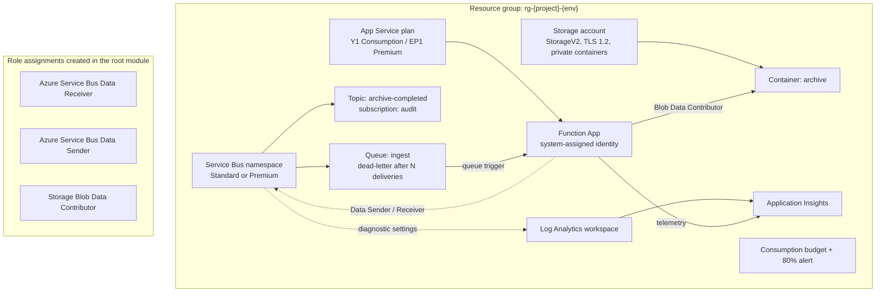

# Architecture and decisions

## Resource graph

## Why a queue *and* a topic

The ingest queue is a work queue: one message, one consumer, competing-consumer
scaling via the Functions runtime. The `archive-completed` topic is a fan-out
point for downstream subscribers that must not block ingestion. Mixing the two
concerns into a single queue usually ends with the ingest path being throttled by
its slowest consumer.

## Ordering and dependencies

Terraform's implicit graph handles almost everything: the resource group before
the modules, the modules before the role assignments (which need the Function
App's `principal_id` and the namespace's `id`). No `depends_on` is used, because
every one of those relationships is visible in an interpolation — the moment a
`depends_on` appears next to a resource whose attributes already establish the
edge, it is hiding a design problem.

The one truly ordering-sensitive thing is outside Terraform: **role assignment
propagation is eventually consistent.** A Function App can start within seconds
of the assignment being created, and its first Service Bus connection may 401
until Entra ID catches up. The function raises on failure, the message is
abandoned, and the next delivery succeeds. That is why the trigger does not
swallow exceptions.

## Naming

`locals.tf` is the single source of truth:

| Resource | Pattern | Constraint driving it |
| --- | --- | --- |
| Resource group | `rg-{project}-{env}` | 1–90 chars, any case |
| Storage account | `st{project}{env}{suffix}`, truncated to 24 | 3–24 chars, **lowercase alphanumeric only**, globally unique |
| Service Bus | `{project}-{env}-sb-{suffix}` | 6–50 chars, alphanumeric + hyphens, globally unique |
| Function App | `{project}-{env}-func-{suffix}` | 2–60 chars, globally unique, becomes a DNS label |
| Plan | `{project}-{env}-plan` | 1–60 chars |

The suffix comes from `random_string` with `keepers` keyed on project and
environment, so it is stable across re-applies and only changes if you rename the
environment. Set `name_suffix` explicitly in a real environment to pin names
completely.

## Managing more than one environment

Each environment gets its own state file (`key = "sbarch/dev/terraform.tfstate"`
in the backend config) but shares the same module code. There is no workspaces
approach here, deliberately: workspaces make it easy to `terraform apply` in the
wrong one because the target is a CLI flag rather than a file in the diff. A
`-var-file` and a `-backend-config` per environment are more typing and far less
ambiguity — and the plan in a pull request always names the environment it
applies to.

## Security posture

**What is already done**

- No secrets in the repository, in state beyond what Azure returns, or in
  application settings consumed by the code.
- SAS authentication is off on the Service Bus namespace
  (`local_auth_enabled = false`). The only way in is Entra ID.
- Storage containers are private (`allow_nested_items_to_be_public = false`) and
  the firewall denies by default as soon as any IP or subnet rule is supplied.
- The Function App only speaks HTTPS, has FTPS disabled and enforces TLS 1.2.
- Least-privilege data-plane roles, scoped to the individual resource rather than
  the resource group.

**What remains, in the order I would do it**

1. **Key Vault** for anything that genuinely must be a secret, with the Function
   App reading through its identity and the vault on a private endpoint.
2. **Private endpoints + VNet integration.** Replace the storage account key for
   the Functions host with `storage_uses_managed_identity = true`, put the
   storage account and Service Bus on private endpoints, and add
   `WEBSITE_VNET_ROUTE_ALL = 1`.
3. **Application Insights via managed identity** instead of the connection
   string: grant the app `Monitoring Metrics Publisher` on the App Insights
   resource and set `APPLICATIONINSIGHTS_AUTHENTICATION_STRING=Authorization=AAD`.
4. **Azure Policy / Defender for Cloud** at the subscription level so the guard
   rails do not depend on this repository being the only entry point.

## Testing strategy

`terraform validate` proves the configuration is internally consistent and
schema-correct, but it proves nothing about whether Azure accepts it. The honest
layers are:

| Layer | Tool | Catches |
| --- | --- | --- |
| Formatting | `terraform fmt -check` | Style drift, keeps diffs reviewable |
| Types and schema | `terraform validate` | Wrong attribute names, bad references |
| Provider best practice | `tflint` + `azurerm` ruleset | Deprecated arguments, invalid SKUs |
| Behaviour | `terraform plan` against a real subscription | Quota, naming collisions, policy denials |
| Outcome | Applying to a scratch subscription and sending a message | RBAC propagation, trigger wiring |

The repository stops at plan in CI. Applying automated infrastructure needs a
human in the loop until the plan output has earned that trust.
